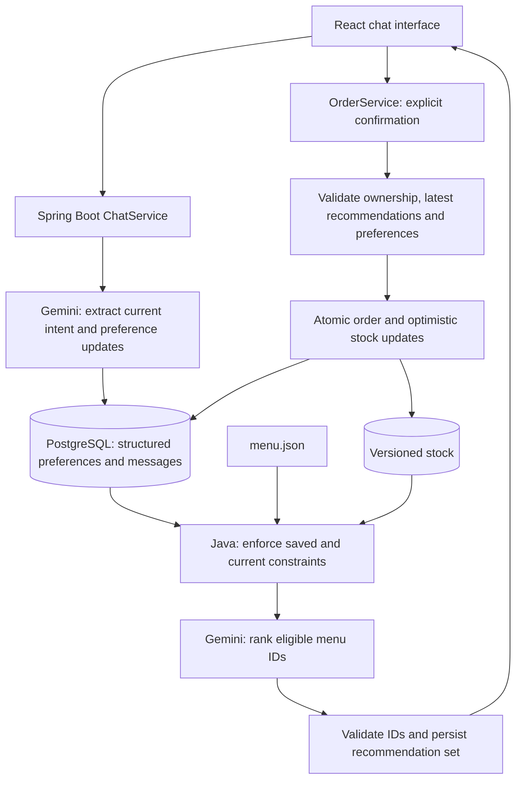

# Table Talk - Restaurant AI Assistant

Table Talk is a conversational restaurant assistant that recommends real menu items, remembers food preferences across conversations, and accepts orders from its latest recommendations.

## Features

- Conversational learning of food likes, dislikes, allergies, dietary restrictions, spice preferences and budget.
- Persistent, user-scoped preferences with explicit corrections and inactive preference history.
- Separate handling of the current meal request and enduring preferences.
- Menu-grounded recommendations with deterministic constraint filtering.
- Returning-user login that restores the latest conversation's last five messages.
- Recommendation-only ordering with quantity selection, price snapshots and order history.
- Optimistic stock locking, atomic checkout and idempotent order submissions.

## Technology

| Layer | Stack |
| --- | --- |
| Frontend | React 19, TypeScript, Vite 7, CSS |
| Backend | Java 21, Spring Boot 4.1.1, Spring MVC, Spring Data JPA, Bean Validation |
| Database | PostgreSQL 16, Flyway migrations |
| AI | Direct Gemini REST integration with structured JSON output |
| Deployment | Multi-stage Docker build; React assets served by Spring Boot |

## Architecture



The application is a single backend service. Gemini interprets language and explains recommendations; Java validates model output, enforces menu constraints and controls database writes. The menu contains 16 items across Burgers, Bowls, Pizza and Salads, with prices, ingredients, allergens, dietary flags and spice levels.

## Run locally

Requirements: Java 21, Maven 3.6.3+, Node.js 20.19+ or 22.12+, npm, Docker Compose and a Gemini API key with access to the configured model. Check that both `java -version` and `mvn -version` use Java 21.

From the repository root:

```bash
cp .env.example .env
# Set GEMINI_API_KEY in .env before using chat.
docker compose up -d --wait
```

Keep an existing `.env` rather than overwriting it.

Start the backend in one terminal:

```bash
set -a
source .env
set +a
mvn -f backend/pom.xml spring-boot:run
```

Start the frontend in another terminal:

```bash
cd frontend
npm ci
npm run dev
```

Open [http://localhost:5173](http://localhost:5173). Vite proxies `/api` to the backend on port 8080. Spring Boot does not load the root `.env` automatically; the commands above export its values. Quote shell metacharacters when entering values in a file loaded with `source`.

If port 5432 is occupied, set `DATABASE_PORT=5433` and `DATABASE_URL=jdbc:postgresql://localhost:5433/restaurant` in `.env`, recreate the database service and reload the environment before starting the backend.

### Environment variables

| Variable | Default | Purpose |
| --- | --- | --- |
| `GEMINI_API_KEY` | Empty | Server-side Gemini API key |
| `GEMINI_MODEL` | `gemini-3.5-flash-lite` | Generation model supporting structured JSON output |
| `GEMINI_BASE_URL` | `https://generativelanguage.googleapis.com/v1beta` | Gemini REST endpoint |
| `DATABASE_URL` | `jdbc:postgresql://localhost:5432/restaurant` | JDBC connection URL |
| `DATABASE_PORT` | `5432` | PostgreSQL host port published by Compose |
| `DATABASE_USERNAME` | `restaurant` | Database username |
| `DATABASE_PASSWORD` | `restaurant` | Local-development database password |
| `RECENT_MESSAGES` | `12` | Previous messages supplied to the model, clamped to 0-50 |
| `PORT` | `8080` | Backend listening port |

API keys stay on the backend. Do not commit `.env` or put secrets in `VITE_*` variables.

### Build

```bash
mvn -f backend/pom.xml clean package
npm --prefix frontend ci
npm --prefix frontend run build
```

The backend artifact is `backend/target/restaurant-assistant-0.0.1-SNAPSHOT.jar`; frontend assets are written to `frontend/dist/`. The root Dockerfile builds and combines both into one runnable application image. See [DEPLOYMENT.md](DEPLOYMENT.md) for deployment instructions.

## Try the application

1. Enter a username. Initial preference setup is optional; it can be skipped to learn preferences through chat.
2. Say: "I am allergic to peanuts, I dislike mushrooms, and I usually prefer spicy food."
3. Start a new conversation and ask: "What would you recommend?" Check that saved preferences remain visible and influence the results.
4. Say: "Actually, mushrooms are fine now." The old dislike becomes inactive.
5. Ask: "I want a chicken bowl under $15 today." The current request narrows recommendations without saving the temporary budget as an enduring preference.
6. Choose quantities on the latest recommendation cards, confirm the order, and view it in order history.
7. Switch usernames to check memory isolation. Log back in to restore the latest conversation's last five messages.

## Preference memory and recommendation rules

PostgreSQL stores structured preferences as the authoritative source of truth. Each preference records its type, value, confidence, source message where available, timestamps, and ACTIVE/INACTIVE status. `UPSERT` and `REMOVE` operations preserve correction history. New explicit likes/dislikes supersede their opposites; budget and spice preferences are single-valued. Liking an ingredient does not remove an allergy.

Extraction distinguishes enduring facts from the current request. "I usually spend under $15" can update long-term memory; "under $15 today" applies to the current meal. Bounded current-conversation history supports follow-up requests. The model does not receive the user's lifetime message history.

Java filters the menu against saved allergies, dietary restrictions, dislikes and budget before applying current-request constraints and stock availability. The stricter saved/current budget applies, per item. Current spice requests use levels 0-1 for mild, 2-3 for medium and 4-5 for spicy. Unavailable foods, unsupported diets and conflicting requirements can produce an explicit no-match response.

Gemini ranks only eligible candidates. The backend rejects unknown, ineligible or duplicate item IDs and constructs recommendation cards using authoritative menu facts. Each successful chat saves its messages, preference changes and recommendation set in one transaction. Extraction failure rolls back the turn. A transient ranking outage after successful extraction can use deterministic ranking of the eligible candidates; malformed selections are rejected.

## Concurrency and ordering

Only items from the latest recommendation set in the owned conversation can be ordered. Checkout rechecks saved preferences and stock. Recommendations do not reserve inventory. Orders are immutable and store item-name and price snapshots; totals use `BigDecimal`.

Stock rows use JPA `@Version`. Concurrent transactions that read the same version cannot both overwrite it successfully: the losing transaction rolls back the entire checkout and returns HTTP `409`. Multi-item checkout is atomic, and a database constraint also prevents negative stock. Ten servings per menu item are seeded once; application restarts do not reset quantities.

A client-generated request UUID is unique per user. An identical retry returns the existing order without another stock deduction. Reusing the UUID with a different payload returns a conflict. The UI retains unresolved submissions for safe retry within the current browser session.

User and conversation rows use pessimistic locks in a consistent order to coordinate preference changes, chat and checkout. Different users can submit concurrently. Requests for the same user are serialized. A stock version conflict can occur even when servings remain; the client receives a conflict and can retry explicitly. This implementation does not automatically retry stock conflicts.

## API

| Method | Endpoint | Purpose |
| --- | --- | --- |
| POST | `/api/users/login` | Find or create a user by username |
| POST | `/api/users/{id}/onboarding` | Save initial preferences, or skip with an empty list |
| POST | `/api/conversations` | Create a conversation |
| GET | `/api/users/{id}/conversations/latest` | Latest conversation and its last five messages |
| POST | `/api/chat` | Process a message and return recommendations and active preferences |
| GET | `/api/users/{id}/preferences` | Active structured preferences |
| GET | `/api/menu` | Menu data |
| POST | `/api/orders` | Place an order from the latest recommendation set |
| GET | `/api/users/{id}/orders` | Latest 20 orders |
| GET | `/api/health` | Database-backed application health check |

Order request:

```json
{
  "userId": 1,
  "conversationId": 10,
  "recommendationSetId": 25,
  "requestId": "2184138d-2f48-46c5-b6b4-190cd044ed87",
  "items": [{ "menuItemId": "spicy-chicken-bowl", "quantity": 2 }]
}
```

The order response includes `id`, `createdAt`, item snapshots, quantities, line totals and `total`. Invalid input returns `400`, missing resources return `404`, foreign conversations return `403`, and ordering conflicts return `409` with a machine-readable code.

## Tests

```bash
# Unit and H2-backed application tests
mvn -f backend/pom.xml test

# Real PostgreSQL integration tests, including synchronized concurrent transactions
backend/scripts/test-database-integration.sh

# Frontend type check and production build
npm --prefix frontend run build
```

The PostgreSQL script creates an isolated container on a random port and removes its test container and anonymous volumes on exit. It requires Docker and Java 21. Set `MAVEN_REPO_LOCAL` to use a custom Maven cache. Database-only tests are skipped unless the integration environment is enabled by the script.

Coverage includes allergy and budget filtering, current intent, preference corrections and persistence, user isolation, five-message history restoration, menu grounding, latest-recommendation validation, idempotent orders, optimistic conflicts, multi-item rollback and V2-to-V3 migration preservation. AI responses are test doubles; automated tests do not establish live Gemini availability or language accuracy.

## Database persistence

Flyway applies versioned migrations at startup. V1 creates the core domain, V2 adds onboarding state, and V3 adds stock, recommendation sets and orders. PostgreSQL data is stored in a named Compose volume. `docker compose down` preserves that data; `docker compose down -v` deletes it. Changing password environment variables does not update credentials in an already initialized database volume.

## Known limitations

- Identity is username-only demonstration access, not authenticated authorization. Anyone who knows a username can select it.
- Language extraction and generated explanations are probabilistic. Allergy filtering depends on extracted facts and complete menu metadata; it does not guarantee kitchen cross-contact safety.
- Chat requires available Gemini service capacity and project quota. Each AI stage has a 45-second budget with bounded retries for transient server errors.
- Chat holds database connections and user locks during AI calls; concurrency correctness tests are not throughput benchmarks.
- The menu is static JSON. Stock is tracked per menu item, with no replenishment endpoint. Orders have no payment, editing or cancellation flow.
- Order history is limited to 20 entries. Pending submission IDs are held in browser state and are lost on reload; check order history before submitting again after an uncertain result and reload.
- Restored assistant messages contain saved recommendation text. Ordering controls appear after a new recommendation response.
